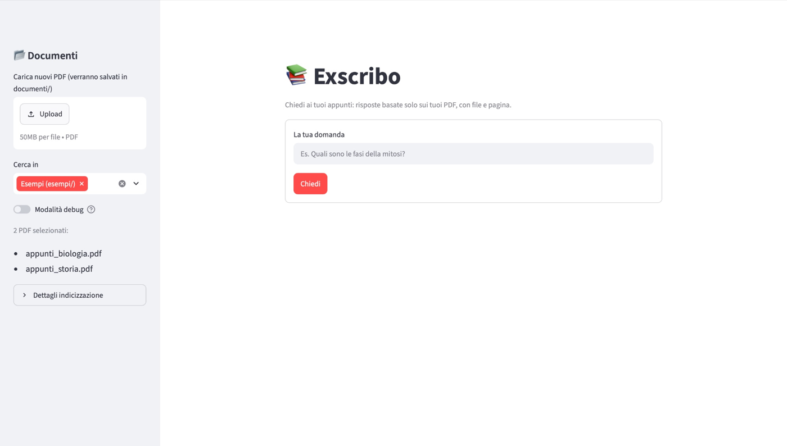
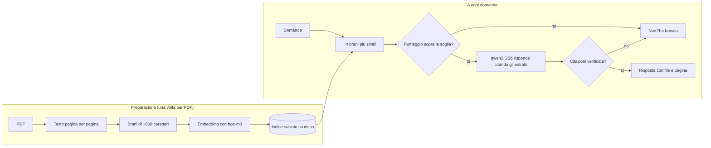

# Exscribo — Chiedi ai tuoi appunti

Carichi i tuoi appunti e le tue slide in PDF, fai una domanda in italiano e ricevi
una risposta basata **solo** su quei documenti, con **il file e la pagina** da cui viene.
Se la risposta non c'è, l'app lo dice chiaramente — *"Non l'ho trovato nei tuoi appunti"* —
invece di inventare.

Funziona **interamente in locale** su un portatile normale: nessun server, nessun
abbonamento, nessun costo, e i PDF non lasciano mai il computer.



## In breve

- **Risposte con fonti verificate**: ogni risposta indica file e pagina, e il programma
  controlla che ogni citazione sia davvero supportata dall'estratto citato.
- **Niente invenzioni**: tre controlli indipendenti fanno rispondere "non trovato"
  quando la risposta non è nei documenti.
- **Misurato**: su 15 domande di prova, **14 risposte giuste e 0 invenzioni**,
  stesso risultato in due esecuzioni ([dettagli](#risultati-della-valutazione)).
- **Leggero**: gira su un MacBook Air M2 con 8 GB di RAM, con circa 1,5 secondi per risposta.
- **Semplice da leggere**: il motore è di circa 600 righe di Python (circa 1.150 con
  interfacce e valutazione), senza framework per l'IA, così ogni passaggio è visibile nel codice.

## Come funziona

L'app usa una tecnica chiamata **RAG** (*Retrieval-Augmented Generation*): prima cerca
nei documenti i brani pertinenti, poi chiede a un modello linguistico di rispondere
usando solo quelli.



1. **Lettura**: il testo di ogni PDF viene estratto pagina per pagina e diviso in brani.
   Ogni brano appartiene a una sola pagina, così ogni informazione ha una posizione precisa.
2. **Embedding**: ogni brano viene trasformato in un vettore di numeri che ne rappresenta
   il significato. Gli embedding vengono salvati su disco e ricalcolati solo per i PDF
   nuovi o modificati, riconosciuti dall'impronta (hash) del loro contenuto.
3. **Ricerca**: la domanda viene trasformata in vettore e confrontata con tutti i brani
   (similarità del coseno); si prendono i 4 più simili.
4. **Risposta**: il modello riceve i brani numerati e risponde citandoli, ad esempio `[1]`.
   File e pagina vengono aggiunti dal programma a partire dal numero, quindi non possono
   essere inventati dal modello.

### Perché non inventa: tre controlli

| # | Controllo | Come funziona |
|---|---|---|
| 1 | **Soglia di pertinenza** | Se nemmeno il brano migliore è abbastanza simile alla domanda, il modello non viene interpellato. |
| 2 | **Segnale del modello** | Il modello è istruito a rispondere `NON_TROVATO` quando gli estratti non bastano. Un esempio svolto nel prompt gli mostra il caso di una domanda di cui conosce la risposta, ma che non è negli estratti. |
| 3 | **Verifica delle citazioni** | Per ogni frase il programma controlla che almeno metà delle parole chiave compaia nell'estratto citato. Le citazioni non supportate vengono tolte; se non resta nessuna fonte, la risposta viene scartata. |

## Risultati della valutazione

Le 15 domande di prova ([`valutazione/domande.json`](valutazione/domande.json)) riguardano
i due PDF di esempio: 9 con risposta negli appunti (dirette, riformulate, una a cavallo di
due file) e 6 senza, di cui 3 fuori tema e 3 sullo stesso argomento ma senza risposta.
Tra queste ultime c'è una domanda trappola: *"In che anno morì Garibaldi?"*, mentre
gli appunti riportano solo l'anno di morte di Cavour.

| Soglia di pertinenza | Risposte giuste | Invenzioni | Falsi "non trovato" | Risposte incomplete |
|---|---|---|---|---|
| da 0.3 a 0.45 | **14/15** | **0** | 0 | 1 |
| **0.4 (in uso)** | **14/15** | **0** | 0 | 1 |
| 0.5 | 14/15 | 0 | 1 | 0 |

Modelli: `qwen2.5:3b` per le risposte, `bge-m3` per gli embedding. Rapporto completo,
domanda per domanda: [`valutazione/risultati.md`](valutazione/risultati.md).

**Cosa ho imparato dalla valutazione:**

- **La soglia da sola non basta.** I punteggi delle domande con e senza risposta si
  sovrappongono: la domanda trappola su Garibaldi ha preso 0.516, quasi quanto una
  domanda valida (0.531 su Villafranca). Nessuna soglia separa questi casi: è stato
  il modello a riconoscerla con `NON_TROVATO`.
- **Le difese del modello reggono.** Anche con la soglia a 0.3 le invenzioni restano zero.
- **Perché 0.4 e non 0.5.** Le due soglie hanno lo stesso punteggio, ma con 0.5 la
  domanda su due file veniva scartata, mentre con 0.4 riceve una risposta parziale con la
  fonte. Inoltre sui PDF reali i punteggi tendono a essere più bassi che sugli esempi,
  quindi una soglia più bassa lascia più margine. Con 15 domande è una scelta
  ragionevole, non una certezza.

Per rifare la misura: `python valuta.py`. Il modello viene interrogato una volta per
domanda e l'effetto delle diverse soglie viene simulato, perché la soglia decide solo
*se* chiamare il modello.

## Scelte tecniche

| Componente | Scelta | Perché |
|---|---|---|
| Modello per le risposte | [Ollama](https://ollama.com) + `qwen2.5:3b` | Gratuito e locale; con 3 miliardi di parametri sta in 8 GB di RAM. |
| Embedding | `bge-m3` via Ollama | Multilingue, capisce bene l'italiano. Usarlo tramite Ollama evita PyTorch (circa 1 GB in meno da installare). |
| Lettura PDF | `pypdf` | Semplice, senza dipendenze di sistema. |
| Ricerca | `numpy` | Per qualche migliaio di brani basta un prodotto tra matrici: nessun database vettoriale da installare. |
| Interfaccia web | Streamlit | Una pagina web in puro Python, in esecuzione solo su `localhost`. |
| Framework RAG | nessuno | Niente LangChain o LlamaIndex: ogni passaggio è scritto esplicitamente e si può leggere nel codice. |

## Requisiti

- macOS con chip Apple (testato su MacBook Air M2 con 8 GB di RAM); dovrebbe funzionare anche su Linux
- Python 3.10 o più recente
- [Ollama](https://ollama.com)
- Circa 3,5 GB di spazio per i due modelli

## Installazione

```bash
git clone https://github.com/Lore2852/Exscribo.git
cd Exscribo

python3 -m venv .venv            # ambiente Python isolato
source .venv/bin/activate
pip install -r requirements.txt

cp .env.example .env             # configurazione

ollama pull qwen2.5:3b           # modello per le risposte
ollama pull bge-m3               # modello per gli embedding

python verifica_ambiente.py      # controlla che sia tutto pronto
```

## Uso

### Interfaccia web

```bash
streamlit run app.py
```

Si apre il browser su `http://localhost:8501`. Dalla barra laterale si caricano nuovi PDF
(salvati in `documenti/`), si sceglie in quali cartelle cercare e si attiva la modalità
debug, che mostra i punteggi dei brani e quale controllo ha fatto scattare un "non trovato".
Cliccando su una fonte si legge l'estratto esatto da cui viene la risposta.
Con i PDF di esempio selezionati, la pagina propone anche tre domande da provare con un clic.
Va avviata dalla cartella del progetto, perché legga la sua configurazione.
Per fermarla: `Ctrl+C` nel Terminale.

### Terminale

```bash
python chiedi.py documenti/                                   # sessione interattiva
python chiedi.py esempi/ "Chi guidò la spedizione dei Mille?"  # una sola domanda
python chiedi.py esempi/ --debug                              # con punteggi e motivi
```

Esempio di risposta:

```
Giuseppe Garibaldi [1]

Fonti:
  [1] appunti_storia.pdf, pagina 4
```

## Configurazione

Le impostazioni sono nel file `.env` (modello: [`.env.example`](.env.example)).

| Variabile | Predefinito | Significato |
|---|---|---|
| `OLLAMA_MODEL` | `qwen2.5:3b` | Modello che scrive le risposte (con 16 GB di RAM o più: `qwen2.5:7b`). |
| `OLLAMA_EMBED_MODEL` | `bge-m3` | Modello per gli embedding. Se lo cambi, l'indice viene ricalcolato da solo. |
| `SOGLIA_PERTINENZA` | `0.4` | Punteggio minimo del brano migliore perché la domanda arrivi al modello. |
| `OLLAMA_URL` | `http://localhost:11434` | Indirizzo di Ollama. |

## Struttura del progetto

```
Exscribo/
├── exscribo/             # il motore dell'app
│   ├── config.py         #   legge la configurazione (.env)
│   ├── pdf.py            #   estrae il testo dai PDF e lo divide in brani
│   ├── modelli.py        #   parla con Ollama (embedding e risposte)
│   ├── archivio.py       #   costruisce l'indice da più PDF e lo salva su disco
│   ├── ricerca.py        #   trova i brani più simili alla domanda
│   ├── citazioni.py      #   verifica le citazioni e le trasforma in file e pagina
│   └── rag.py            #   istruzioni al modello e i tre controlli anti-invenzione
├── app.py                # interfaccia web (Streamlit)
├── chiedi.py             # interfaccia da Terminale
├── valuta.py             # misura gli errori sulle domande di prova
├── verifica_ambiente.py  # controlla che l'ambiente sia pronto
├── valutazione/          # domande di prova e risultati
├── esempi/               # PDF di esempio (contenuto inventato, pubblico)
├── documenti/            # i tuoi PDF (esclusi da Git)
├── indice/               # embedding salvati (generata, esclusa da Git)
└── .streamlit/           # configurazione dell'interfaccia web
```

## Privacy

- Tutto avviene sul computer: i modelli girano in locale con Ollama, e nessun testo
  viene inviato a servizi esterni.
- L'interfaccia web è raggiungibile solo da `localhost`, non dagli altri dispositivi della
  stessa rete. Le statistiche d'uso di Streamlit sono disattivate e il pulsante per
  pubblicare l'app online è nascosto (vedi [`.streamlit/config.toml`](.streamlit/config.toml)).
- Il `.gitignore` esclude dal repository il file `.env`, la cartella `documenti/`,
  qualsiasi PDF che non sia in `esempi/` e la cartella `indice/`, che contiene pezzi
  di testo dei documenti.

## Limiti noti

- **PDF scansionati**: l'app legge solo PDF che contengono testo. Una scansione è
  un'immagine e richiederebbe il riconoscimento ottico dei caratteri (OCR), non incluso.
- **Slide con poco testo**: grafici, schemi e immagini vengono ignorati; si legge solo il testo.
- **Domande doppie**: con una domanda su due argomenti diversi il modello tende a
  rispondere solo a una parte. Nella valutazione, a *"Chi formulò la teoria cellulare e
  chi fondò la Giovine Italia?"* ha risposto *"Matthias Cellulare e Giuseppe Mazzini..."*:
  la seconda parte è giusta, la prima è un nome storpiato.
- **La verifica delle citazioni lavora sulle parole, non sul significato**: controlla
  frasi intere, quindi un piccolo errore dentro una frase per lo più corretta (come
  "Matthias Cellulare") può passare. Al contrario, una risposta giusta ma riformulata
  con molti sinonimi può perdere la citazione.
- **Risposte a volte parziali**: un modello da 3 miliardi di parametri tende a essere
  sbrigativo (per esempio cita il crossing-over ma non l'assortimento indipendente).
- **Piccoli errori di scrittura**: il modello a volte storpia una parola (per esempio
  "profaso" invece di "profase"); la verifica delle citazioni non se ne accorge, perché
  confronta solo le prime lettere delle parole.
- **Valutazione piccola**: 15 domande su due PDF di esempio scritti in modo ordinato.
  Su appunti reali i punteggi di somiglianza sono in genere più bassi.
- **Brani divisi per pagina**: una frase a cavallo tra due pagine viene spezzata.
- **Nomi di file duplicati**: due PDF con lo stesso nome in cartelle diverse vengono
  mostrati con lo stesso nome nelle fonti.

## Possibili sviluppi

- OCR per i PDF scansionati.
- Un modello più grande (`qwen2.5:7b`) su computer con più memoria, misurando la
  differenza con `valuta.py`.
- Scomporre le domande doppie in domande singole prima della ricerca.
- Una verifica delle citazioni basata sul significato (embedding delle singole frasi)
  invece che sulle parole.
- Un insieme di domande di prova più ampio.

## Licenza

[MIT](LICENSE) — © 2026 [Lore2852](https://github.com/Lore2852)
